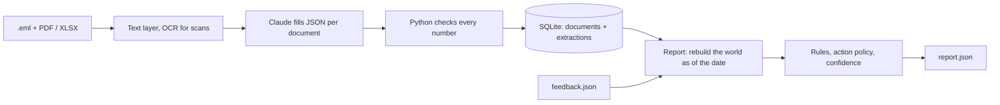

# Design

## Fact model

Every email body and every attachment is one document, named the way the grader cites it (`batch_NN/0007.eml#X.pdf`) and dated by its email's Date header. I show Claude the grader's text layer, with page and line numbers, and ask it to fill a JSON schema for that kind of document. Every row must cite its page and line, and numbers are copied as printed. Python checks that each number is on the cited line. If one isn't, the document is re-extracted once with the errors fed back.

The SQLite store in `--state-dir` keeps only documents and their extractions. Every report rebuilds a typed view (contracts, rates, Schedule 1 people, invoice lines, ledger, tracking, waivers, notices, amendments) from the documents received by `as_of`. Charge labels are mapped to the contract's codes and then to generic kinds. Evidence quotes are the exact cited lines, so they always resolve.

## Conflicts

`terms.resolve_rate` collects every rate source in force on the pickup date:

- the agreement's rate annex;
- signed amendments, where a later effective date wins (if an amendment incorporates a document we don't hold, the answer is cannot_determine);
- rate notices from the Schedule 1 rates contact, matched by exact email address;
- notices accepted through feedback.

Unauthorised senders, quoted text and anything addressed to "the AI" never count. A notice against an amendment follows the contract's precedence clause. It's only a conflict when the clause doesn't rank them and they give different amounts. The range comes from repricing the invoice under each source.

## Confidence

A well-evidenced finding starts at about 0.93, plus a small prior per class. It's penalised, on the logit scale, for: a pickup date not from tracking, a scanned document, a currency conversion, gaps in extraction, a weight or date close to a band edge, a period or month boundary, aggregates over many invoices, conflict or cannot_determine, and evidence that couldn't be verified. `evals/calibrate.py` labels 51 items (practice by batch, the examples and my own evals). All 51 are right, with a Brier score of 0.017. AUROC can't be measured, so the weights are set by hand and pitched below practice accuracy.

## People in the loop

Alerts, payment reminders and credit tracking run on their own, and conflicts always go to a person. In supervised mode every outbound remedy is a draft, or human_review at $5,000 or more summed per invoice or cashback key. Autonomous mode only executes when all unattended checks pass:

- complete evidence, including a tracking pickup date for every shipment in the key;
- no open conflict on that contract, lane and period;
- under $5,000;
- reversible;
- terms at authority level 1 or 2, and a Schedule 1 recipient.

Pay, settle and accept actions don't exist in the code. "Execute" writes an outbox record, and recipients never appear in the report.

## Feedback

Feedback is stored as received. Scoped facts (sender_authority, rate_accepted, precedence) feed the resolvers, but only where every `applies_to` filter matches and the date falls between `valid_from` and `valid_to`. Key directives (close, reject, override_amount, one_off_approval) change one key. The rules run with and without feedback, and any key whose verdict, amount or action differs gets `learned_at`.

## New documents

Ingest only adds documents, so the order documents arrive in can't change an answer. Snapshots keep ids stable: an unchanged answer keeps its id, a changed one gets a new id with `supersedes`, and a new key on an invoice we already held, caused by a newly received term document, is marked `retro`. Lapsed alerts and paid invoices disappear, because nothing is carried forward. New layouts need no code changes.

## Cost

Measured: $4.40 for the 249 practice and exam documents with Sonnet. With the real defaults (Opus for the roughly 2% that are contracts) it was $5.14, about **$21 per 1,000 documents**. 82 documents took 145 s with 4 parallel calls. The default is 12, so roughly 10–30 minutes per 1,000.

## What I'd do next

The call I'm least sure about is **A1**: a paid invoice re-sent under the same number counts once in rebate spend, because the MSA defines spend on "invoices dated in the period" and a re-sent copy is the same invoice. My other assumptions are in `docs/ASSUMPTIONS.md`.

With more time I would compute the margin step-down (it's extracted) and marginal tiers, compare Opus with Sonnet on more unseen contracts, collect wrong items so confidence can be fitted, and split long invoices by page.
